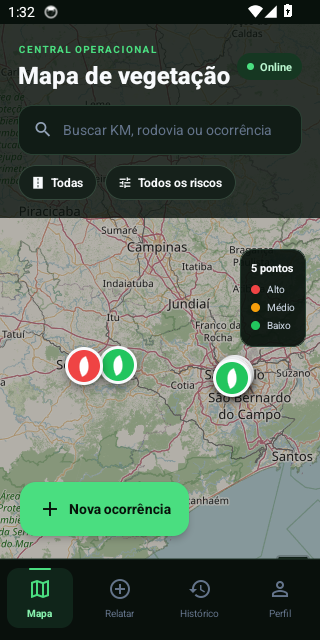
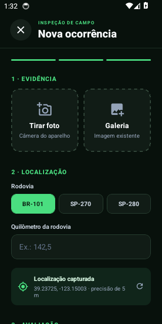
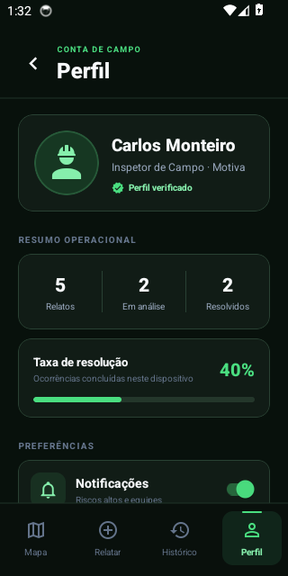

# Motiva Verde — Gestão Inteligente de Vegetação

Aplicativo multiplataforma para a gestão das áreas verdes das rodovias operadas pela Motiva. A solução reúne em uma única experiência, voltada às equipes de inspeção e operação, o registro de ocorrências em campo com foto e GPS, a classificação de risco, o mapa de prioridades, o despacho de equipes e o histórico auditável de cada intervenção.

## Downloads e links

| Entrega | Link |
| --- | --- |
| 📱 **APK Android (versão final)** | [**Baixar motiva-verde.apk**](https://github.com/rafadonas/Sprint1-CPAD/releases/latest/download/motiva-verde.apk) · [todas as versões](https://github.com/rafadonas/Sprint1-CPAD/releases) |
| 🎬 **Vídeo final de pitch e demonstração (Sprint 4)** | _Link do YouTube (não listado) a ser incluído após a gravação_ |
| 🎥 Vídeos anteriores | [Sprint 2](https://youtu.be/vOX8zfhRCqA) · [Sprint 3](https://youtu.be/QX9XWHr-NKw) |
| 💼 Plano de negócio | [PLANO_DE_NEGOCIO.md](./PLANO_DE_NEGOCIO.md) |
| ✅ Relatório de testes | [TESTES_MANUAIS.md](./TESTES_MANUAIS.md) |

## Capturas do APK

<p>
  
  
  
</p>

## Proposta de solução

Hoje a roçagem na faixa de domínio costuma seguir um cronograma fixo, e os registros de campo ficam espalhados entre planilhas, fotos e mensagens. O **Motiva Verde troca a roçagem por calendário pela roçagem por risco**:

1. **O inspetor registra a ocorrência** com foto da câmera, coordenadas do GPS, rodovia, KM, altura estimada e nível de risco.
2. **A central visualiza o mapa** de pontos georreferenciados, com filtros por rodovia e risco.
3. **O app recomenda o prazo de intervenção** de acordo com o risco: imediata, até 24 h, até 72 h ou monitoramento.
4. **A equipe é despachada e o atendimento é concluído** no app, e cada etapa entra em uma linha do tempo auditável.
5. **A gestão acompanha os indicadores** de pendências, ocorrências críticas abertas e taxa de resolução.

O impacto esperado é menos roçagem desnecessária, atendimento mais rápido dos trechos críticos, mais segurança viária e evidências para responder ao poder concedente. Os detalhes estão no [plano de negócio](./PLANO_DE_NEGOCIO.md).

## Instalação do APK (Android)

1. No celular Android, abra o link [**motiva-verde.apk**](https://github.com/rafadonas/Sprint1-CPAD/releases/latest/download/motiva-verde.apk) e faça o download.
2. Abra o arquivo baixado. Se o Android pedir, autorize **Instalar apps desconhecidos** para o navegador ou o gerenciador de arquivos (**Configurações > Apps > Acesso especial > Instalar apps desconhecidos**).
3. Toque em **Instalar**. Se o Play Protect avisar que o app é desconhecido, toque em **Mais detalhes > Instalar mesmo assim**, porque o APK é distribuído fora da Play Store.
4. Abra o **Motiva Verde**. Ao registrar a primeira ocorrência, permita o acesso à **localização** e à **câmera**.

Requisitos: Android 7.0 (API 24) ou superior e conexão com a internet para carregar os blocos do mapa.

Instalação por cabo (opcional), com a depuração USB ativada:

```bash
adb install motiva-verde.apk
```

## Funcionalidades da versão final

| Funcionalidade | Descrição |
| --- | --- |
| Mapa operacional | OpenStreetMap interativo com zoom, arraste, marcadores por risco, busca, filtros por rodovia e risco e legenda |
| Registro de ocorrência | Foto real pela **câmera ou galeria**, **GPS do aparelho** com precisão exibida, rodovia, KM, altura, risco, descrição e validações |
| Persistência local | Ocorrências e alterações de status **ficam salvas no aparelho** e continuam lá depois que o app é fechado |
| Histórico | Busca, filtros por status, indicadores de pendências e de ocorrências críticas e estado vazio |
| Detalhes e prioridade | Foto da evidência, dados da inspeção, coordenadas, tags, prazo recomendado e linha do tempo |
| Ciclo de atendimento | **Pendente → Em análise (despacho) → Concluído**, com confirmação em cada etapa |
| Perfil | Estatísticas, taxa de resolução, preferências e **restauração dos dados de demonstração** |
| Robustez | Fallback de localização quando a permissão é negada, erros de câmera tratados, botão voltar do Android e áreas seguras |

## Stack utilizada

- **Expo SDK 56**, React Native 0.85, React 19 e TypeScript
- expo-image-picker (câmera e galeria) e expo-location (GPS)
- AsyncStorage (persistência local)
- OpenStreetMap, Leaflet e React Native WebView (mapa)
- React Native Web (mesma base de código para a Web)
- **GitHub Actions** para o build do APK (Expo Prebuild + Gradle), teste automatizado de instalação em emulador Android e publicação no GitHub Releases
- `eas.json` configurado para quem preferir gerar o APK pelo Expo EAS Build

> **Sobre Flutter:** o grupo não migrou para Flutter. O projeto foi desenvolvido inteiramente em React Native com Expo nas quatro Sprints, e essa base única atende Android, iOS e Web.

## Resumo das entregas por Sprint

| Sprint | Foco | Principais entregas | Evidência |
| --- | --- | --- | --- |
| **Sprint 1** | Ideação e escopo | Problema definido: falta de visão geográfica dos trechos críticos e dificuldade em despachar equipes de roçada. Público-alvo definido: operador de campo e gestor de operações. Escopo do MVP: cadastro de ocorrência com KM, foto, altura e GPS, mapa de ocorrências, classificação de risco por cores e tela de detalhes com despacho. Também foi criada a estrutura inicial do projeto Expo + TypeScript | README da Sprint 1 no histórico do repositório |
| **Sprint 2** | MVP navegável | Mapa de riscos sobre fundo geográfico de São Paulo, formulário de registro, histórico atualizado após cada cadastro, detalhes com botão "Despachar equipe", perfil do inspetor e menu inferior entre as áreas, tudo com dados mockados e tema escuro | [Vídeo da Sprint 2](https://youtu.be/vOX8zfhRCqA) |
| **Sprint 3** | Protótipo funcional | Validações de formulário, estados alternativos (zero resultados, lista vazia, ação já executada), mapa OpenStreetMap interativo, busca e filtros, linha do tempo, modal de confirmação, toasts, acessibilidade, áreas seguras, botão voltar do Android e relatório com 15 casos de teste | [Vídeo da Sprint 3](https://youtu.be/QX9XWHr-NKw) · [testes](./TESTES_MANUAIS.md) |
| **Sprint 4** | Versão final | Pendências da Sprint 3 corrigidas: persistência local, câmera e GPS reais, conclusão do atendimento e restauração de dados. Também entraram o **APK publicado** no GitHub Releases, o pipeline de build com teste em emulador, o [plano de negócio](./PLANO_DE_NEGOCIO.md) e o vídeo de pitch | [APK](https://github.com/rafadonas/Sprint1-CPAD/releases/latest/download/motiva-verde.apk) · vídeo final |

### Evolução ao longo das Sprints

| Recurso | Sprint 1 | Sprint 2 | Sprint 3 | Sprint 4 |
| --- | --- | --- | --- | --- |
| Mapa | Escopo | Imagem estática com marcadores | OpenStreetMap interativo com filtros | Inclui os pontos registrados pelo GPS |
| Registro | Escopo | Formulário simples | Validações e estados de erro | Câmera ou galeria e GPS reais |
| Dados | — | Mock em memória | Mock em memória | Persistidos no aparelho |
| Atendimento | Escopo | Botão de despacho | Despacho com confirmação e linha do tempo | Ciclo completo até a conclusão |
| Distribuição | — | Expo Go | Expo Go no emulador | **APK instalável** |

### Pendências da Sprint 3 resolvidas

| Ponto do relatório da Sprint 3 | Solução na Sprint 4 |
| --- | --- |
| Dados voltavam ao estado inicial quando o app era reiniciado | Persistência com AsyncStorage |
| Foto simulada | Câmera e galeria reais com pré-visualização e remoção |
| Geolocalização simulada | GPS do aparelho, com fallback para a referência da rodovia |
| CT-13 (botão voltar do Android) estava "Repetir no emulador" | Revalidado no APK instalado |
| Ciclo de atendimento terminava no despacho | Nova ação **Concluir atendimento** |
| Validação em ambiente nativo | APK instalado e iniciado automaticamente em emulador Android no CI |

## Como executar em desenvolvimento

Pré-requisito: Node.js 20.19 ou superior.

```bash
npm install
npm start
```

No terminal do Expo, pressione `a` para Android, `i` para iOS ou `w` para Web, ou escaneie o QR Code com o Expo Go.

### Validação técnica

```bash
npm run typecheck
npx expo-doctor
npm run build:web
```

### Gerar o APK

**GitHub Actions (usado na entrega):** ao publicar uma tag `v*`, o workflow [`android-apk.yml`](./.github/workflows/android-apk.yml) gera o APK, instala e abre o app em um emulador Android e anexa o `motiva-verde.apk` a um GitHub Release.

```bash
git tag v1.0.0
git push origin v1.0.0
```

**Expo EAS Build (alternativa):**

```bash
npx eas-cli login
npx eas-cli build --platform android --profile preview
```

> O APK não é versionado no repositório. Ele fica disponível apenas pelo GitHub Releases.

## Limitações conhecidas e próximos passos

- Os dados ficam no aparelho. O roadmap prevê backend com autenticação e sincronização entre dispositivos.
- O mapa precisa de internet. O cache offline de blocos está planejado.
- O `expo-doctor` aponta uma regressão de memória do Hermes no SDK 56. A migração para o SDK 57 está planejada.
- Estão previstas notificações push, perfis de acesso e classificação da vegetação por visão computacional.

## Integrantes

- Pedro Henrique dos Santos Cardoso — RM 563268
- Gabriel Gibin Leoncio — RM 565462
- Rafael do Nascimento Silva — RM 566263
- Rai Augusto Ribeiro — RM 562870
- Guilherme Morais de Assis — RM 564198
- Lucas Werpp Franco — RM 556044

Projeto acadêmico da disciplina Cross-Platform Application Development, ministrada por Hercules Lima Ramos.
